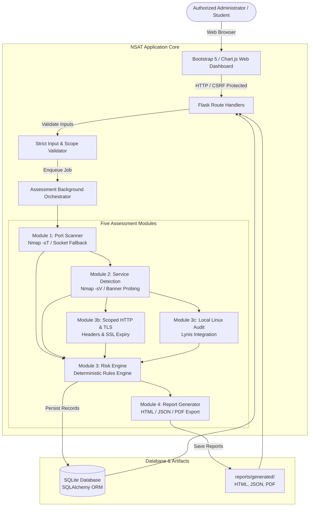

# Network Security Assessment Toolkit (NSAT)

[](https://www.python.org/downloads/)
[](LICENSE)
[](tests/)
[](#defensive-security-notice)

**Network Security Assessment Toolkit (NSAT)** is a modular, transparent, and user-friendly defensive cybersecurity auditing platform. Built with Python, Flask, SQLAlchemy, and Bootstrap 5, it enables authorized system administrators, network engineers, and students to evaluate private network assets, identify open TCP services, assess configuration hygiene, audit local Linux operating systems, and generate professional security assessment reports.

---

## 🛡️ Defensive Security Notice & Scope Policy

> [!IMPORTANT]
> **STRICT DEFENSIVE SCOPE ONLY:** NSAT is strictly engineered for defensive, authorized assessments of network assets and operating systems you own or have explicit written authorization to audit.
>
> **Built-in Safety Protections:**
> - **Default Localhost Binding:** The web application binds to `127.0.0.1:5000` by default.
> - **Private Scope Restriction:** Scans only accept RFC 1918 private IPv4 addresses (`10.0.0.0/8`, `172.16.0.0/12`, `192.168.0.0/16`) and local loopback (`127.0.0.1`, `::1`). Arbitrary public targets and DNS hostname resolution are strictly rejected.
> - **Zero Exploitation or Brute-Forcing:** NSAT does **not** perform credential brute-forcing, exploit execution, evasion, denial-of-service, stealth scanning, or persistence.
> - **Transparent Findings:** Unverified exposures are never claimed to be confirmed exploits. Severity is kept separate from evidence confidence.

---

## 🏗️ System Architecture



---

## ✨ Core Features & Modules

### Module 1: Network Port Scanner
- Non-root unprivileged TCP connect scanning (`-sT` with Nmap).
- Pure-Python socket scanner fallback when Nmap is unavailable on the host system.
- Strict input validation: RFC 1918 private targets and loopback only.
- Bounded scans: Rate limiting, maximum 1000 ports limit, and process timeouts.
- Defensive XML parsing (`xml.etree.ElementTree`) for machine-readable reliability.

### Module 2: Service & Version Identification
- Banner probing and `-sV --version-light` service fingerprinting.
- Identifies common enterprise services: SSH, HTTP, HTTPS, FTP, Telnet, SMB, RDP, MySQL, Postgres, Redis, VNC.
- Separates observed banners from inferred port defaults.
- Details potential operational risks and administrative recommendations for each service.

### Module 3: Security Risk Assessment Engine
- Rule-based deterministic scoring model (0.0 to 100.0) based on impact and evidence confidence.
- Severities: `Critical`, `High`, `Medium`, `Low`, and `Informational`.
- Evidence confidence: `High`, `Medium`, and `Low`.
- Transparent findings with technical evidence, reasoning, remediation guidance, and references.
- Deduplication of findings across scans.

### Module 3b: Scoped HTTP & TLS Auditing
- Scoped HTTP response header analysis (`Content-Security-Policy`, `Strict-Transport-Security`, `X-Frame-Options`, `X-Content-Type-Options`, `Referrer-Policy`).
- Server banner leakage detection.
- TLS certificate inspection: Days until expiration, expired flags, and deprecated protocol checks (`SSLv3`, `TLS 1.0`, `TLS 1.1`).
- Bounded 3-second timeouts, bounded chunk reads, and strict no-redirect policy.

### Module 3c: Local Linux Host Auditing (Lynis)
- Native integration with Lynis for local Linux system auditing.
- Captures system warnings, suggestions, and hardening index.
- Distinguishes local host auditing from remote network scanning.

### Module 4: Professional Report Generator
- **Interactive HTML Report:** Self-contained, responsive report with executive summary and finding cards.
- **Structured JSON Export:** Complete schema with assessment metadata, port observations, and findings.
- **Printable PDF Export:** Generated via ReportLab with tables, risk summaries, and formal disclaimers.

### Module 5: Non-Technical Friendly Web Dashboard
- **Overview Dashboard:** Severity breakdown donut charts, risk trend bar charts, and system readiness cards.
- **New Assessment Wizard:** Port presets (Top 20, Web, Databases), timeout slider, module checkboxes, and review modal.
- **Real-Time Assessment Tracking:** Automatic status polling every 2.5s with live progress indicators.
- **Scan Comparison Diff:** Side-by-side comparison of two assessments to highlight newly opened ports and resolved issues.
- **System Health Monitor:** Live dependency checks for Python, Nmap, Lynis, and SQLite database size.

---

## 🛠️ Technology Stack

| Component | Technology | Role |
| :--- | :--- | :--- |
| **Language** | Python 3.11+ | Backend application logic & typing |
| **Web Framework** | Flask 3.1+ | REST routes, session management, blueprints |
| **Security Layer** | Flask-WTF / CSRFProtect | Cross-Site Request Forgery mitigation |
| **Database ORM** | SQLAlchemy 2.0+ / SQLite | Relational persistence behind repository pattern |
| **Validation** | Pydantic & `ipaddress` | Strict type and defensive scope enforcement |
| **Frontend UI** | Bootstrap 5.3 & Bootstrap Icons | Accessible, high-contrast responsive interface |
| **Data Visualization** | Chart.js 4.4 | Real-time severity donut and risk bar charts |
| **Network Assessment** | Nmap & Python `socket` | XML port scanning with pure socket fallback |
| **System Auditing** | Lynis | Local Linux host configuration auditor |
| **HTTP / TLS** | `requests` & `ssl` | Bounded header checks & X.509 cert analysis |
| **PDF Reporting** | ReportLab 5.0+ | Cross-platform PDF document generation |
| **Testing** | pytest, pytest-cov, ruff | Automated unit/integration tests & code linting |

---

## 🚀 Installation & Quick Start

### Option A: Debian / Ubuntu / Kali Linux (Automated)

1. Clone or extract the repository:
   ```bash
   cd NSAT
   ```

2. Make the setup script executable and run it:
   ```bash
   chmod +x scripts/setup_linux.sh
   ./scripts/setup_linux.sh
   ```

3. Start the application:
   ```bash
   source venv/bin/activate
   python wsgi.py
   ```

4. Open your browser to **http://127.0.0.1:5000**.

### Option B: Linux Manual Installation

```bash
# 1. Install system tools
sudo apt-get update
sudo apt-get install -y python3 python3-venv python3-pip nmap lynis

# 2. Create virtual environment
python3 -m venv venv
source venv/bin/activate

# 3. Install dependencies
pip install --upgrade pip
pip install -r requirements.txt

# 4. Run automated test suite
pytest -v

# 5. Launch web application
python wsgi.py
```

### Option C: Windows Development

```powershell
# 1. Create virtual environment
python -m venv venv
.\venv\Scripts\Activate.ps1

# 2. Install dependencies
pip install --upgrade pip
pip install -r requirements.txt

# 3. Run automated tests
pytest -v

# 4. Start web application
python wsgi.py
```

*Note on Windows:* If Nmap is installed and added to Windows PATH, Nmap scanning will be used; otherwise, NSAT automatically operates via its built-in Python socket fallback. Lynis is specific to Linux systems and will be reported as skipped on Windows.

---

## 🧪 Running Automated Tests

Run the complete 63-test suite with coverage:

```bash
pytest -v --cov=app --cov-report=term-missing
```

Run code formatting and lint verification:

```bash
ruff check app tests
```

---

## 📊 Understanding Assessment Results

| Severity | Criteria | Example |
| :--- | :--- | :--- |
| **Critical** | Severe unauthenticated exposure or compromised security perimeter | Unauthenticated database on public segment |
| **High** | Cleartext management protocol, sensitive exposure, or expired TLS cert | Telnet exposed (Port 23), SMB exposed (Port 445), Expired TLS cert |
| **Medium** | Database exposed on LAN, deprecated TLS version, or missing core CSP | MySQL port open (3306), Redis without network isolation, TLS 1.0 |
| **Low** | Missing standard security headers or server software banner disclosure | Missing X-Frame-Options or Server header disclosure |
| **Informational** | Expected baseline services operating within standard security profiles | Open SSH service (Port 22) or standard HTTPS service (Port 443) |

---

## 📁 Project Directory Structure

```text
NSAT/
├── app/
│   ├── __init__.py                # Flask application factory
│   ├── config.py                  # Environment and security configurations
│   ├── extensions.py              # SQLAlchemy and CSRFProtect instances
│   ├── models/                    # Database models
│   │   ├── assessment.py          # Assessment execution model
│   │   ├── asset.py               # Target asset registry
│   │   ├── event.py               # Audit trail events
│   │   ├── finding.py             # Security findings
│   │   ├── port_result.py         # Port scan results
│   │   ├── report.py              # Report artifact records
│   │   ├── service_observation.py # Identified service banners
│   │   └── tool_execution.py      # Subprocess command logs
│   ├── routes/                    # Web controllers
│   │   ├── assessments.py         # Assessment wizard and details
│   │   ├── dashboard.py           # Overview metrics & charts
│   │   ├── findings.py            # Security findings explorer
│   │   ├── reports.py             # Report generation & downloads
│   │   └── settings.py            # System health & diagnostics
│   ├── services/                  # Business & security services
│   │   ├── assessment_service.py  # Background threaded execution worker
│   │   ├── http_checks.py         # Scoped HTTP header evaluator
│   │   ├── lynis_service.py       # Local Linux Lynis audit runner
│   │   ├── nmap_service.py        # Nmap XML execution and parser
│   │   ├── report_service.py      # HTML, JSON, and PDF report generator
│   │   ├── risk_engine.py         # Deterministic vulnerability rules engine
│   │   ├── service_detection.py   # Service enrichment and recommendations
│   │   ├── socket_scanner.py      # Bounded socket scanner fallback
│   │   └── tls_checks.py          # TLS handshake & cert inspector
│   ├── static/                    # CSS, JavaScript, and assets
│   ├── templates/                 # Jinja2 HTML templates
│   └── utils/                     # Subprocess, logging, and validation utilities
├── docs/                          # In-depth architectural documentation
├── scripts/                       # Linux setup & packaging utilities
├── tests/                         # Pytest test suite (63 unit & integration tests)
├── Dockerfile                     # Hardened container image definition
├── compose.yaml                   # Container orchestration
├── Makefile                       # Development convenience targets
├── requirements.txt               # Pinned dependencies
├── pyproject.toml                 # Package metadata and tool configurations
├── wsgi.py                        # WSGI entrypoint script
└── README.md                      # Primary documentation
```

---

## ⚖️ License & Ethical Conduct

This project is licensed under the MIT License. Use strictly within authorized, legal boundaries.
