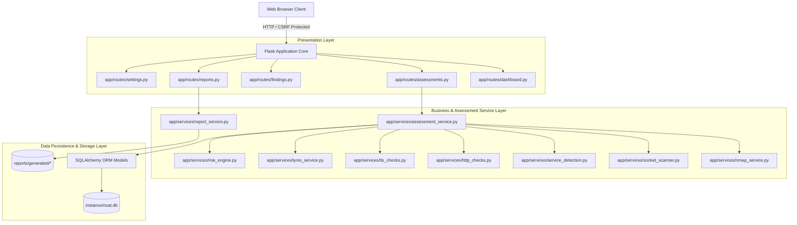
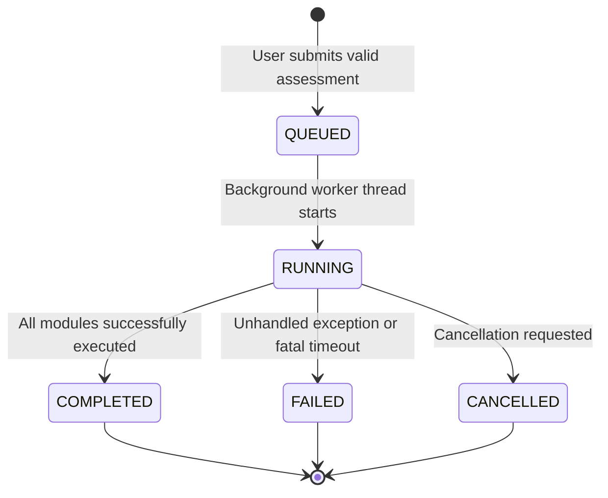

# NSAT Architecture Specification

## 1. Architectural Philosophy & Design Goals

The **Network Security Assessment Toolkit (NSAT)** is designed as a modular, layered defensive auditing system. The design emphasizes:

1. **Separation of Concerns:** External tools (Nmap, Lynis, sockets, OpenSSL) are encapsulated behind clean service interfaces. Web controllers never invoke subprocesses directly.
2. **Defensive Safety by Design:** Host input validation, port range bounds, and process timeouts are enforced at multiple levels (UI, controller, service layer).
3. **Reproducibility & Traceability:** Every scan stores the exact command line executed, tool exit code, execution duration, and raw tool output preview in the `ToolExecution` model.
4. **Resilient Data Persistence:** Database interactions use SQLAlchemy ORM behind repository patterns, allowing future seamless migration from SQLite to PostgreSQL.

---

## 2. Component Diagram

---

## 3. Database Schema & Entities

The application implements 8 relational database entities:

1. **`Assessment`**: Central record storing scan metadata, target IP, status (`QUEUED`, `RUNNING`, `COMPLETED`, `FAILED`, `CANCELLED`), risk score, start/end timestamps, and duration.
2. **`TargetAsset`**: Unique host record tracking discovered IP addresses, asset type, and first/last seen timestamps.
3. **`PortResult`**: Observation of a single TCP port state (`open`, `closed`, `filtered`), observation reason, and protocol.
4. **`ServiceObservation`**: Identified service name, product, software version, detection method, and confidence rating.
5. **`Finding`**: Prioritized security finding containing severity, confidence, category, evidence, rationale, and remediation.
6. **`AssessmentEvent`**: Append-only audit trail logging milestones, warnings, and errors.
7. **`ReportArtifact`**: Metadata record of generated HTML, JSON, or PDF files.
8. **`ToolExecution`**: Process execution log capturing the exact CLI arguments, exit code, duration, and output preview.

---

## 4. Background Execution Lifecycle State Machine

- When an assessment is initiated, it is validated synchronously, saved with status `QUEUED`, and launched via Python's standard `threading` module inside a managed worker thread.
- The web frontend periodically polls `/assessments/<id>/status` via lightweight JSON requests every 2.5 seconds to refresh the user interface dynamically.
- Graceful cancellation is supported by checking `cancellation_requested` flags between scanning stages and port iterations.
